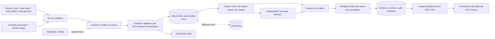

# SENTINEL-X architecture

## Default single-node topology

## Event contract

The normalized envelope is ECS-inspired, not complete ECS conformance. It includes event ID and UTC timestamp; source; category/type/action; host/user; process name, command line, PID, parent name, parent command line and parent PID; source/destination IP and ports; protocol; file path; outcome; severity; tags; and the original raw source record. Sysmon XML is preserved in raw_event.raw_xml.

Adapters accept Zeek JSON lines, Suricata EVE JSON lines, Sysmon XML event records, Linux audit text, and generic JSON. The synthetic generator is inert and deterministic for a fixed seed/time anchor.

## Processing and integrity

1. Source adapters map source-specific fields while retaining original evidence.
2. Pydantic validates the event. Invalid records enter dead_letters.
3. SQLite WAL commits each event under a unique event ID. Duplicate IDs are suppressed and audit logged.
4. Native YAML rules and the documented Sigma subset create alerts. Alert uniqueness is event_id + rule_id; duplicate suppression is audit logged.
5. The median/MAD burst detector compares current-minute event volume against prior active buckets and requires minimum history.
6. Correlation uses weighted host, host-scoped user, domain-qualified identity, host-scoped PID/parent PID and private-IP keys. It uses source event time, not ingest wall-clock time; case timelines are sorted by event time.
7. Cases retain ATT&CK context, evidence references, entity match explanations, heuristic risk ranking, analyst feedback and audit history.

## Storage and optional integrations

SQLite WAL is authoritative for events, alerts, incidents, feedback and audit. ClickHouse is an optional analytical mirror; normal hunt queries always read SQLite, while /api/v1/analytics/events explicitly queries ClickHouse. Existing SQLite data can be copied using bounded sentinel-x backfill-clickhouse batches. Mirror failures are dead-lettered and counted; no cross-database transaction is claimed.

Kafka/Redpanda uses manual offset commits after processing (at-least-once); event IDs make re-delivery safe. Prometheus exports HTTP and application metrics. OpenTelemetry traces are opt-in and use OTLP/HTTP.

## Boundaries

The Sigma adapter implements a tested subset, not the full Sigma specification. The anomaly detector is an interpretable statistical heuristic, not trained ML. The 0–100 risk score is triage priority, not compromise probability. ATT&CK mappings are contextual hypotheses, not proof of compromise or attribution.

Default event retention is indefinite. No automatic TTL/deletion is configured. Initial lab target is 100 events/sec; this is a target, not a guarantee. SQLite is a laptop-scale default.
